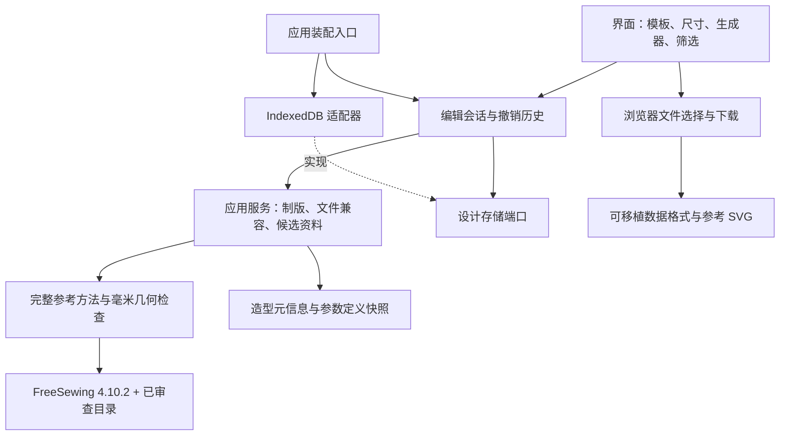

# 服装造型系统架构整理 · 2026-11-10

后续已新增完整适配器中的结构合同、逐边用途、配缝方向与组成校验，并修复过肩对折计数；最新软件验收范围与结果见 [系统结构与裁片组成验收范例](系统结构与裁片组成验收范例-20261110.md)。本文的文件数和测试数保留为第一轮架构整理时的历史结果。

本轮完成运行架构的第一轮解耦：以完整参考制图为主线，退出模拟部件和成本猜算，集中设计输入与检查结果，分离存储、文件操作和飞书候选资料。该结论不代表专业制版或生产验收已经完成。

## 一、责任与依赖

| 位置 | 负责什么 | 必须遵守的边界 |
| --- | --- | --- |
| `src/types/` | 测量、路径、几何、设计文档及存储端口 | 不依赖实现模块 |
| `src/data/` | 审查目录、源测量样本、飞书快照与参数语义 | 不依赖界面、编辑状态或存储 |
| `src/lib/pattern/`、`patterns/` | Brian/Teagan/Sven/Simon 适配与检查 | 不引入 React、数据库或旧模拟引擎 |
| `src/application/` | 完整制版结果、输入校验、文件兼容与候选登记 | 接受显式输入；不读界面状态、DOM 或数据库 |
| `src/store/designStore.ts` | 当前输入、单一派生结果、会话与历史、异步操作保护 | 存储通过端口注入 |
| `src/store/useDesignStore.ts` | 装配默认编辑器与 IndexedDB | 具体存储依赖只在装配层接入 |
| `src/store/pieceLibraryStore.ts` | 标签、选择、隐藏和当前部位 | 不保存第二份检查结果，不提供人工放行失败项 |
| `src/lib/db/` | 原本地数据库的读写实现 | 以事务提交为成功；不在启动时迁移或删除数据 |
| `src/features/files/` | 浏览器文件选择和下载 | 与纯数据格式分开 |
| `src/features/`、`components/` | 交互与显示，包括尚未应用的尺寸预览 | 不自建模拟裁片或生产批准 |

`computeDraft` 是当前设计派生结果的唯一所有者：完整生成、按源裁片编号分组、检查源版本与基础几何后，再供画布、总览和检验清单使用。修改颜色、纹理、名称或视图不触发重新制图。生成器的未应用输入独立暂存，只有应用后才进入当前设计；临时输入绑定原始测量快照和编辑会话，不跨设计遗留。

`npm run check:architecture` 会拒绝核心依赖界面/存储、纯模块引用浏览器全局、重新导入旧引擎、缺失本地依赖或循环依赖，并验证归档哈希。纯类型文件不进入运行时依赖图，报告中的四个 unreachable 合同文件仍被 TypeScript 使用，保留是必要的。

## 二、退出运行的内容

旧 Gene/DAG 组装、模拟袖口/领襟、猜测 BOM/成本、Konva 画布、SQLite 草稿实验、重复设计面板与旧预设均退出入口。无用的 `immer`、`konva`、`react-konva`、`react-router-dom`、`@types/uuid` 五项依赖已移除。

原文件移到 `research/legacy/`，共保存 109 份文件备份：102 项移动、7 项替换前副本。原始 SHA256 全部核对通过，见 `doc/evidence/architecture-20261110/retired-files.json`。归档内旧测试与历史脚本不执行，不能计入当前通过次数；归档代码的旧导入路径也不保证可直接运行。

一次性 `verify-shape-collaboration.py` 包含历史视图设置写入，已归档，不作为普通“只读验证”脚本继续使用。旧 E2E 保存为历史来源，现行脚本另行维护。

AI 与元素库面板改为首次展开后加载；AI 输出只允许引用已审查的具体模板。缺少构型时必须保留缺口，不按类别找替代模板，不接收任意 Block、尺寸或生产批准。

运行时可达文件从 106 降至 68，文本行数从 17,379 降至 9,892；统计包含 JSON 与动态加载模块，只说明运行依赖范围收敛，不等同于性能或专业精度证明。

## 三、设计保存、兼容与数据保护

新文档格式为 `garment-os/design/v3`，保存模板、14 项明确测量输入、松量方案、源引擎版本、外观配置、视图、名称、标签及时间。几何与检查结果根据输入重算，不另存一套模拟实例或成本。

仍使用原 `garment-innovation` 数据库及版本 2，保留原 `designs`、`fabrics`、`patterns` 存储。历史设计若有完整、兼容的 `draftInputs`，在读取时转换到新合同；读取不写回。无原始输入、版本不符或数据不完整时明确拒绝，当前设计不变，不以示例尺寸补齐。缺日期的历史记录仍可在列表中发现；未知分组不填为男装。

存储成功以完整事务提交为准。请求返回成功但事务随后撤销时，保存仍判失败。连接失败后可重试，阻塞连接后续打开的过期句柄会关闭。连续明确保存串行写到同一文档，保留最新一次输入；延迟保存/载入不能覆盖新会话或后续编辑。撤销历史属于每个编辑器，保留 undefined、NaN 等缺失/无效语义，不能转成零。

## 四、与飞书协同

继续使用原有两张业务表：服装元素 `tblI4uKwuTbKFFeT` 和参数定义 `tblBubbOzjlF7B9g`。本轮没有新建、删除或写入飞书业务表，也没有重读全库冒充实时同步。

前端保留原始来源标识、记录链接、组成关系、生成依据、参数编码、来源版本和限制。候选资料的核心生成函数显式接收设计配置与元素库快照，不再自行读取界面状态；文件下载独立。资料包继续采用 v2.0、原有 UUID 内容指纹和未知项 null 语义；只支持 Brian 的候选登记协议。

本轮已用当前候选包对照本地历史 schema/源记录运行 Python 导入器的纯校验：3 片通过。该结果证明交换格式兼容，不代表飞书实时状态或实际写入成功。

| 运维脚本 | 用途与影响 |
| --- | --- |
| `sync-shape-library.py` | 读取两表，完整校验后替换本地快照；不写飞书 |
| `import-design-registrations.py` / `.ps1` | 默认预检；显式 apply 后才创建缺失的待核验裁片并回读 |
| `publish-template-review.py` | 默认预检；显式 apply 后按既有范围更新审查元信息并回读 |
| `summarize-template-review.py` | 汇总上一阶段的本地模板审查证据；不是本轮架构验收 |

## 五、实际验证结果

| 检查 | 本轮结果 |
| --- | --- |
| 架构边界/循环依赖 | 0 违规、0 循环；109 份归档完整 |
| 代码检查、类型检查、正式构建 | 通过 |
| 当前软件测试 | 15 个文件，197 项通过；旧归档测试不计入 |
| 独立上游标准对照 | 重建模板 84 个样本 + Brian 42 个样本；逐路径、控制点等对照保持一致 |
| 跨页面组件联动 | 标签改变实际路径与裁片列表；隐藏不放行失败项；缺失输入阻断；未应用尺寸不跨会话 |
| 保存与存储 | 原始输入/路径往返、旧设计兼容、缺失保护、事务撤销、异步隔离、连续保存、历史素材保留与标签保留通过 |
| 候选包交换 | 本地归档 schema 校验 3 片通过；飞书写入 0 |
| 本地服务 | 首页与主要模块 HTTP 200；不等同于浏览器渲染验收 |
| 浏览器操作与新截图 | 未执行、未验收；Work 设置禁用浏览器使用 |

完整命令入口：`npm run check`。结果在 `doc/evidence/architecture-20261110/`；`final-check.txt` 是末轮完整软件检查，`verification-summary.json` 为末轮结果汇总，`before.json`/`after.json` 为结构对照。

现行 `scripts/e2e-reference.mjs` 已按当前页面更新并通过语法检查，等待浏览器允许使用的环境中实际执行。每次运行写入新的截图目录，覆盖参考图、真实尺寸响应、空筛选、禁止使用的模板、五个可执行模板和保存恢复。脚本本轮未运行，不能声称它已经通过，更没有新截图可作为验收证明。

## 六、仍需完成的专业建设

1. **界面验收**：实际浏览器逐项操作与截图，确认所有新增流程和 E2E 工作流；组件 DOM 检查不能替代。
2. **构型方法**：V领、短/长袖Polo、梭织女衬衫仍待重建；Simon 领底需独立裁片，袖口与两种袖衩缺少上游布纹依据。继续禁止虚构补齐。
3. **制造合同**：明确测量协议、材料伸缩/缩率、逐边缝份与缝合配对、剪口与衬料层、放码、排料与真实 BOM。数值采样和参考走缝阈值不是生产公差。
4. **制造验证**：目标 CAD 文件往返、1:1 打印、实物试坯和专业制版批准均未完成。系统始终 `productionApproved:false`。
5. **依赖与性能**：生产依赖审计仍报告 18 个受影响包节点（17 高、1 中），源头为 FreeSewing 依赖链的 `lodash.set`/`lodash.unset`。自动建议会降级已固定的源制图版本，不能直接强制执行；需要单独评估修补或受控替换并重新做 126 样本对照。主包约 916 kB，仍有体积提示；测试工具另有 esbuild/oxc 弃用提示。

本轮完成的是可维护、可验证的架构基础，专业模板与生产放行仍按上述缺口逐项推进。原工作区已有改动继续保留，未提交、推送或清空历史数据。
