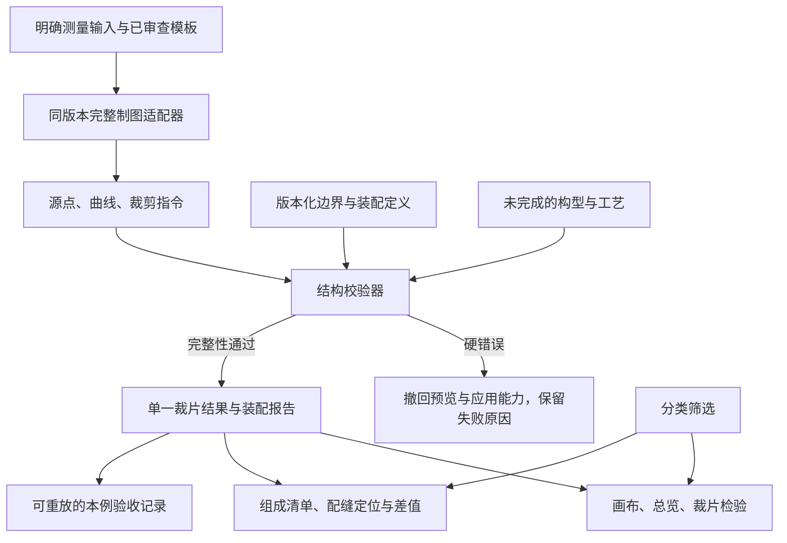

# 系统结构与裁片组成验收范例

本次按“系统架构、裁片与组成逻辑”验收，不要求提供工厂或实物试坯资料。验收对象是系统能否用同一套来源明确的规则生成、定位、检查和追溯裁片，并正确拦截错误。这里的结构检查通过，不等同于所有款式已经具备完整制造工艺。

## 一、固定的验收基础

- 图形来源：FreeSewing 4.10.2 的完整 Brian、Teagan、Sven、Simon 方法，不混用不同引擎或版本的零件。
- 坐标：源裁片局部坐标，单位 mm；布置位置和界面缩放不参与走缝长度计算。
- 接口：依据指定的源点名与连续净边链定位，不通过名称相似、包围框、最近点或外观判断配对。
- 边界规则：`assembly-v1`，包含明确的用途、方向、端点语义、用片次数和层数。每条非零净边均须归属某个边界。
- 裁剪：读取每种材料的实际裁剪指令。对折展开用于配缝容量计算，不将一片对折裁片误记为两片。

本轮特别修复了过肩的错误对折标签：Simon 过肩继承了后身的旧注释，实际材料指令为完整过肩裁两片。现在结构清单、筛选标签和图形元信息均以材料指令为准。

### 检查限值的含义

| 项目 | 本例规则 | 依据与边界 |
| --- | --- | --- |
| 同源共享肩缝、过肩接缝、对称袖底缝、基础款侧缝 | 差值绝对值 ≤ 0.01 mm | 数值一致性检查，不是制造公差 |
| Simon 独立塑形的前后侧缝 | 单侧差值绝对值 ≤ 1 mm | 本系统选定的工程验收范例限值；不是上游保证或行业通用标准。超限阻断，不自动修改曲线 |
| 配套袖山与完整袖窿 | 单袖差值绝对值 ≤ 2 mm，当前方案设定吃势为 0 | 来自上游袖山拟合的迭代停止值，不是工厂公差；左右袖分别检查，不能互相抵消 |
| 褶、翻折、搭门等尚未定义完成态的接口 | 不设置假公差 | 显示原始净边差并保持待定义；差值为 0 也不自动通过 |

首轮回归显示，Simon 独立塑形侧缝在参考样本中确有非零差值（最大约 0.863 mm）。因此将其与应当完全一致的共享边分开定义。1 mm 是公开的范例策略，不能通过加宽任意接口的阈值绕过语义、方向、用片或待定义约束。

长度使用源引擎的曲线积分，保留未四舍五入的比较值；界面显示到 0.001 mm 不代表已证明同等制造精度。闭合、连续、有效控制点和数值长度均须通过；另增加自交、重叠与零面积检查。自交检查使用自适应细分，属于软件防错，尚不构成经过认证的 CAD 拓扑内核。

## 二、架构的实际分工



具体边界如下：

| 层 | 职责 | 禁止行为 |
| --- | --- | --- |
| `types/assembly.ts` | 独立的裁片、接口、用片与报告合同 | 依赖 React、数据库或显示坐标 |
| `data/assemblyPlans.ts` | 每种方法的明确裁片集合、源文件、边界、配缝方向与数量 | 不同方法随意拼装；没有装配定义仍执行 |
| `lib/pattern/assembly/source.ts` | 从同一次完整制图捕获原始点、净边和材料指令 | 重新画近似轮廓；用继承注释覆盖材料指令 |
| `lib/pattern/assembly/validate.ts` | 来源、边界覆盖、走缝、方向顺序、用片容量与关系连通检查 | 最近点兜底；忽略缺片；重复使用同一实体接口 |
| `lib/pattern/assembly/topology.ts` | 轮廓退化与自交防错 | 将数值细分检查宣传为 CAD 内核认证 |
| 完整源适配器 | 在缓存和展示前执行结构检查 | 生成器绕过检查先显示错误裁片 |
| `application/draft-service.ts` | 汇总当前设计的唯一结果；硬失败撤回路径 | 留下上一套尺寸的图形冒充当前有效结果 |
| `application/assembly-record.ts` | 导出当前输入及对应报告，拒绝过期结果 | 把导入报告中的“通过”当成放行权限 |
| `features/piece-library/AssemblyPanel.tsx` | 组成、配缝和筛选的展示 | 筛选后把完整模板检查降成少数可见片检查 |

保存设计仍保存原始输入，载入后重算。结构规则与 CAD 明细沉淀在版本化定义和本地记录中；飞书继续使用既有服装元素、参数定义两张表，不增加日志表。本轮未向飞书写入，也不把当前本地快照说成实时同步。其他模板的候选登记协议仍须独立建立，不能假借 Brian 的来源关系登记。

## 三、验收范例 A：完整衬衫组成

参考输入：`button-up-shirt / male / M / regular`，对应上游测试体型 `cisMaleAdult38`。测试体型用于重放软件检查，不是用户实测体型。

在页面依次选择“男装长袖衬衫 · Simon”→“裁片库”→“裁片组成”。

| 裁片 | 上游面料裁剪数量 | 对折 | 组成含义 |
| --- | ---: | --- | --- |
| 左前身、右前身 | 各 1 | 否 | 两个独立身份，各自保留连身门襟 |
| 后身 | 1 | 是 | 一片对折展开的后身 |
| 过肩 | 2 | 否 | 内外两层完整过肩 |
| 袖片 | 2 | 否 | 左右袖；每袖单独检查袖山配套 |
| 领面参考片 | 2 | 否 | 上游指令保留；差异领底尚须独立拆分 |
| 领座 | 2 | 否 | 内外两层 |
| 袖口 | 4 | 否 | 两只袖口，每只内外两层 |
| 袖衩外搭片、内搭片 | 各 2 | 否 | 每只袖分别配置内外搭片 |

预期：10 种源裁片、89 条非零净边全部分类、14 组关系。其中 9 组走缝与方向检查通过，5 组完成态装配保持待定义。源材料指令合计 19 片面料、6 片衬料；这只是参考指令计数，尚非制造下料单。

关键配缝示例：

| 关系 | 本例 A−B 差值 | 系统结果 |
| --- | ---: | --- |
| 左右肩缝、后身接过肩、两袖袖底缝 | 约 0 mm | 数值一致性与方向通过 |
| 单侧前后侧缝 | -0.124 mm | 公开的 1 mm 范例限值内 |
| 单袖袖山与前后身、过肩组成的袖窿 | -1.073 mm | 上游 2 mm 迭代限值内；两袖各自检查 |
| 衣身领窝接领座 | +1.118 mm | 待定义门襟折返后的端点及领座搭门 |
| 领面接领座上边 | -9.174 mm | 待将领隙映射到实际剪口，并拆分领底 |
| 两袖下口接双层袖口 | +54.400 mm，合计原始净边差 | 待做褶量和袖衩折返变换，不按原始全长配对 |
| 袖衩内、外搭片长度基准 | 0 mm | 仍待定义翻折、转角及车缝路径，不能凭长度相同放行 |

这里的“组成完整性通过”表示裁片、边界、材料数量和已声明关系自洽。关系图连通检查包含待定义关系；它不证明这些关系已经能完成制造装配。

完整记录：[衬衫范例 JSON](evidence/assembly-20261110/button-up-shirt.example.json)。其中包含全部输入、源几何、逐边记录和完整报告，可用同一版本方法重新计算。

## 四、验收范例 B：定位、筛选与尺寸变化

1. 在“裁片组成”点击“领面与领座上边”。应显示源净样灰线，以及对应接口的橙色净边；不得用矩形或示意曲线替代。该关系结果保持“装配待定义”。
2. 选择“领类”。组成清单只显示领面和领座，关系列表只显示相关的两组关系，图形也只显示符合筛选的裁片。完整性摘要仍为 10 种裁片、89/89 条净边。
3. 清除筛选，选择“口袋类”。本款没有口袋，应显示空状态并撤掉旧图，不显示上一张裁片。
4. 清除筛选，将当前设计尺码从 M 改为 L。接口位置、长度和装配报告必须随同一套新输入重算。
5. 点击“导出本例验收记录”。导出的尺寸必须与当前设计一致，且记录所有待定义项；不能导出过期报告冒充当前结果。
6. 将颈围改为空值。生成器撤掉预览、禁止应用；若当前设计输入无效，组成面板也撤掉旧报告。缺失值不填零，不自动套用测试样本。

以上交互已用真实 React 组件事件与 DOM 断言验证。它们不属于浏览器截图证据。

## 五、验收范例 C：故障必须被识别

自动流程对源裁片或结构定义进行有意破坏，检查以下情况均被拦截：

| 故障类别 | 代表案例 |
| --- | --- |
| 身份与来源 | 缺领座、重复袖片、增加未声明口袋、混版本、混引擎 |
| 裁剪组成 | 过肩误标对折、袖口四层误改两层、材料清单与数量不符 |
| 净样几何 | 缺源点、伪造长度、真实拉长侧缝、断边、无效控制点、闭合但自交的轮廓 |
| 配缝语义 | 侧缝接肩缝、袖底方向倒置、袖窿顺序打乱 |
| 关系占用 | 重复使用肩缝、必配接口未配对、切口同侧重复使用、孤立裁片 |
| 错误放行 | 将尚未完成翻折的袖口改成“长度相等”规则，即便设极大阈值仍阻断 |

自动矩阵覆盖 126 组源体型、尺码和松量组合；另有 22 种故障注入。Brian 包含两组测试体型的数值回归，这不表示已完成女装合体方法验收。

运行方式（在 `garment-os` 目录）：

```powershell
npm run test:assembly
npm run check
```

第一条重放结构矩阵、故障与组成界面的组件交互，并生成 5 份 M 码范例 JSON；第二条执行完整架构、代码、测试与构建检查。独立上游源对照仍由原有 84 个重建模板样本和 42 个 Brian 样本负责；结构矩阵与源对照分别统计，不把两者混称同一项证据。

- [矩阵与故障结果](evidence/assembly-20261110/acceptance-matrix.json)
- [Brian 范例](evidence/assembly-20261110/brian-reference.example.json)
- [圆领短袖范例](evidence/assembly-20261110/t-shirt.example.json)
- [收腰针织范例](evidence/assembly-20261110/womens-basic-tee.example.json)
- [长袖针织范例](evidence/assembly-20261110/long-sleeve-tee.example.json)

## 六、本次验收边界

软件验收检查与实际通过数量见同目录 `final-check.txt`、`verification-summary.json`，以末轮结果为准。

当前 Work 设置返回 `Local browser use is disabled in Work settings`。因此本轮没有真实浏览器操作或新截图，不认定视觉验收成功。已补充 `scripts/e2e-reference.mjs` 的组成、净边定位及筛选步骤；脚本只做语法检查，实际运行会另行生成截图与结果。

V 领、短袖 Polo、长袖 Polo、梭织女衬衫仍禁止生成，旧 T-Shirt Pro 仍合并停用。未完成的完整构型不能用圆领或全开襟改名替代。

系统已具备可扩展、可重放的结构合同与防错链路。后续补某一裁片时，应同时提交其源方法、点与边、材料裁剪指令、方向与装配关系、参数回归和失败范例；不能只补一张图，再将缺少规则的接口设为通过。
